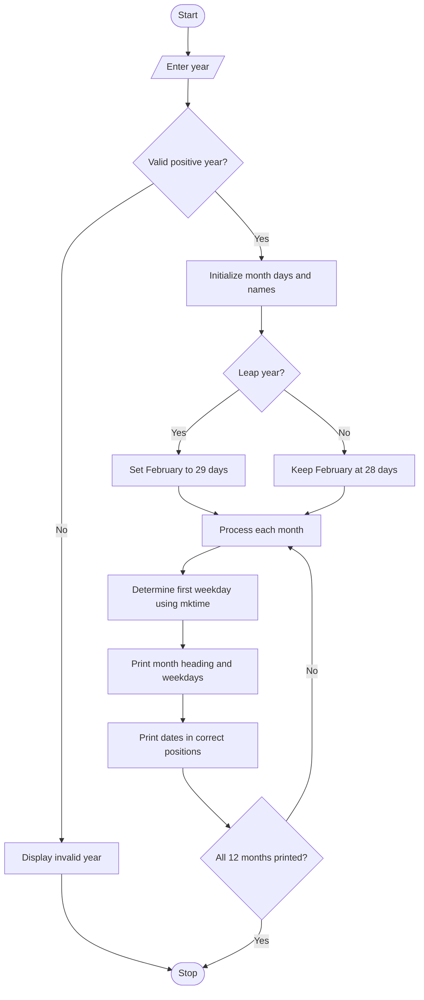

# Calendar-Generation-in-C


# Assignment 10: Generating a Month-by-Month Calendar in C

## 1. Problem Statement

Write a C program to print the month-by-month calendar for a given year.

## 2. Objectives

- To implement date and time functions in C programming.
- To understand the use of the `stdio.h` and `time.h` header files.
- To determine whether a year is a leap year.
- To understand the Gregorian calendar rules for leap years.
- To calculate the number of days in each month.
- To determine the first weekday of each month.
- To display a formatted calendar for all 12 months of a given year.

## 3. Theory

### What Are Date and Time Functions in C?

C provides date and time functionality through the `time.h` header file. These functions and structures allow programs to represent dates, calculate calendar information, and work with time values.

In this assignment, date and time functionality is used to determine the weekday on which each month begins.

### Essential Header Files

#### 1. `stdio.h`

The `stdio.h` header file provides standard input and output functions, including:

- `printf()` — displays information on the screen.
- `scanf()` — accepts input from the user.

#### 2. `time.h`

The `time.h` header file provides date and time-related functionality.

This program uses:

- `struct tm` — stores broken-down calendar information, including year, month, day, and weekday.
- `mktime()` — converts a broken-down calendar time into a `time_t` value and normalizes the calendar structure.

The `tm_wday` member of `struct tm` represents the weekday, where Sunday is `0`, Monday is `1`, and Saturday is `6`.

### How Does the Program Determine Whether a Year Is a Leap Year?

A leap year contains 366 days instead of the usual 365 days. February has 29 days during a leap year.

The program uses the following condition:

```c
if ((year % 400 == 0) ||
    (year % 4 == 0 && year % 100 != 0))
{
    /* Leap year */
}
```

This condition checks the following rules:

- If a year is divisible by 400, it is a leap year.
- If a year is divisible by 4 but not by 100, it is a leap year.
- Otherwise, it is not a leap year.

**Examples:**

- 2024 — leap year.
- 2000 — leap year.
- 1900 — not a leap year.
- 2025 — not a leap year.

### What Are the Gregorian Calendar Rules for Determining a Leap Year?

The Gregorian calendar follows a specific rule to keep the calendar year aligned with the Earth's orbit around the Sun.

A year is a leap year if it is divisible by 4, except for century years that are not divisible by 400.

For example, 2000 was a leap year because it was divisible by 400, while 1900 was not because it was divisible by 100 but not by 400.

### How Does the Program Calculate the Number of Days in Each Month?

The number of days in each month is stored in an integer array.

```c
int daysInMonth[] = {
    31, 28, 31, 30, 31, 30,
    31, 31, 30, 31, 30, 31
};
```

The array represents January through December.

- January, March, May, July, August, October, and December have 31 days.
- April, June, September, and November have 30 days.
- February has 28 days in a normal year and 29 days in a leap year.

When the program identifies a leap year, it changes the February entry from 28 to 29.

### How Does the Program Determine the First Day of a Month?

The program initializes a `struct tm` structure with the given year, month, and day set to `1`.

The `mktime()` function normalizes this structure and calculates the corresponding weekday, which is stored in `tm_wday`.

The program uses this weekday to position the first date correctly under the appropriate weekday heading.

### How Is the Calendar Displayed?

The program prints the month name and year, followed by the weekday headings from Sunday to Saturday.

It then prints blank spaces before the first date, according to the weekday on which the month begins. The remaining dates are printed in sequence, with new lines inserted at the end of each week.

## 4. Algorithm

1. Start the program.
2. Declare an integer variable to store the year.
3. Accept the year from the user.
4. Validate that the year is a positive integer.
5. Initialize an array containing the number of days in each month.
6. Define an array containing the names of all 12 months.
7. Check whether the year is a leap year.
8. If it is a leap year, change February's number of days to 29.
9. Repeat the following steps for each month:
   - Initialize a `struct tm` structure for the first day of the month.
   - Use `mktime()` to determine the weekday of the first day.
   - Print the month name, year, and weekday headings.
   - Print blank spaces before the first date.
   - Print all dates in the month in the correct positions.
10. Display all 12 months.
11. Stop the program.

## 5. C Program

```c
#include <stdio.h>
#include <time.h>

int main()
{
    int year, month, day;

    int daysInMonth[] = {
        31, 28, 31, 30, 31, 30,
        31, 31, 30, 31, 30, 31
    };

    char *monthNames[] = {
        "January", "February", "March", "April",
        "May", "June", "July", "August",
        "September", "October", "November", "December"
    };

    char *weekDays[] = {
        "Sun", "Mon", "Tue", "Wed",
        "Thu", "Fri", "Sat"
    };

    struct tm date = {0};

    printf("Enter year: ");

    if (scanf("%d", &year) != 1 || year < 1)
    {
        printf("Invalid year.\n");
        return 1;
    }

    if ((year % 400 == 0) ||
        (year % 4 == 0 && year % 100 != 0))
    {
        daysInMonth[1] = 29;
    }

    for (month = 0; month < 12; month++)
    {
        date = (struct tm){0};

        date.tm_year = year - 1900;
        date.tm_mon = month;
        date.tm_mday = 1;
        date.tm_isdst = -1;

        if (mktime(&date) == (time_t)-1)
        {
            printf("Unable to calculate calendar.\n");
            return 1;
        }

        printf("\n\n       %s %d\n",
               monthNames[month], year);

        for (int i = 0; i < 7; i++)
        {
            printf("%4s", weekDays[i]);
        }

        printf("\n");

        for (int i = 0; i < date.tm_wday; i++)
        {
            printf("    ");
        }

        for (day = 1; day <= daysInMonth[month]; day++)
        {
            printf("%4d", day);

            if ((date.tm_wday + day) % 7 == 0)
            {
                printf("\n");
            }
        }

        if ((date.tm_wday + daysInMonth[month]) % 7 != 0)
        {
            printf("\n");
        }
    }

    return 0;
}
```

### Explanation of the Program

- `#include <stdio.h>` provides input and output functions such as `printf()` and `scanf()`.
- `#include <time.h>` provides the date and time structure and functions.
- `daysInMonth[]` stores the number of days in each month.
- `monthNames[]` stores the names of all 12 months.
- `weekDays[]` stores the weekday headings.
- `struct tm date = {0};` initializes the calendar structure.
- `scanf("%d", &year)` accepts the year entered by the user.
- The `if` condition checks whether the year follows the Gregorian leap year rules.
- `daysInMonth[1] = 29;` changes February to 29 days in a leap year. Array indexing begins at zero, so index `1` represents February.
- `for (month = 0; month < 12; month++)` repeats the calendar-generation process for all 12 months.
- `date.tm_year = year - 1900;` stores the year as the number of years since 1900, as required by `struct tm`.
- `date.tm_mon = month;` sets the month, using January as `0` and December as `11`.
- `date.tm_mday = 1;` sets the date to the first day of the month.
- `mktime(&date)` normalizes the date structure and calculates the weekday.
- `date.tm_wday` provides the weekday number of the month's first day.
- The first inner loop prints spaces before the first date so that it appears under the correct weekday.
- The second inner loop prints every date of the month.
- The conditional statements insert line breaks after each week.

## 6. Sample Input and Output

### Operation: Generate a Calendar for a Given Year

**Input:**
```text
Enter year: 2024
```

**Sample Output:**

The program displays all 12 months of 2024. The beginning of the output will look like this:

```text
       January 2024
 Sun Mon Tue Wed Thu Fri Sat
       1   2   3   4   5   6
   7   8   9  10  11  12  13
  14  15  16  17  18  19  20
  21  22  23  24  25  26  27
  28  29  30  31


       February 2024
 Sun Mon Tue Wed Thu Fri Sat
                   1   2   3
   4   5   6   7   8   9  10
  11  12  13  14  15  16  17
  18  19  20  21  22  23  24
  25  26  27  28  29
```

The calendar continues for March through December.

**Note:** The program uses Sunday as the first day of the week. The sample output illustrates the date placement; the exact spacing is determined by the `printf()` formatting in the program.

## 7. Flowchart



## 8. FAQs

### Q1. What are the essential header files used in this program, and what are their roles?

The program uses two header files:

- `stdio.h` provides standard input and output functions such as `printf()` and `scanf()`.
- `time.h` provides date and time structures and functions, including `struct tm` and `mktime()`.

### Q2. How does the program determine if a year is a leap year?

The program checks whether the year is divisible by 400 or divisible by 4 but not by 100.

```c
if ((year % 400 == 0) ||
    (year % 4 == 0 && year % 100 != 0))
{
    daysInMonth[1] = 29;
}
```

If the condition is true, February has 29 days. Otherwise, it has 28 days.

### Q3. What are the Gregorian calendar rules for determining a leap year?

A year divisible by 4 is generally a leap year. However, century years must also be divisible by 400 to qualify as leap years.

For example, 2000 is a leap year, but 1900 is not.

### Q4. How does the program calculate the number of days in each month?

The program stores the number of days in an array. Each array position corresponds to a month, starting with January at index `0` and ending with December at index `11`.

February's value is changed to 29 if the entered year is a leap year.

### Q5. What is the significance of leap year conditions in a calendar program?

Leap year conditions ensure that February contains the correct number of days. Without this check, the program would generate an incorrect calendar for leap years.

### Q6. How can the program determine the first day of the year?

The program can initialize a `struct tm` structure for January 1 of the given year and use `mktime()` to obtain the weekday in `tm_wday`.

In this implementation, the program determines the first weekday of each month using the same method.

### Q7. What is the purpose of `struct tm`?

`struct tm` stores broken-down calendar information, including the year, month, day, weekday, hour, minute, and second.

The program uses its `tm_year`, `tm_mon`, `tm_mday`, and `tm_wday` members to calculate and display the calendar.

### Q8. Why are nested loops used in the calendar program?

The outer loop processes all 12 months. The inner loops print the weekday headings, position the first date, and display each date in the month.

This makes it possible to generate the complete calendar without writing separate code for every month.

## 9. Conclusion

Thus, a C program was implemented successfully to generate a formatted month-by-month calendar for a given year. The experiment demonstrated the use of date and time functions, arrays, loops, and conditional statements. It also provided an understanding of Gregorian leap year rules, the number of days in each month, and how to determine the first weekday of a month.
